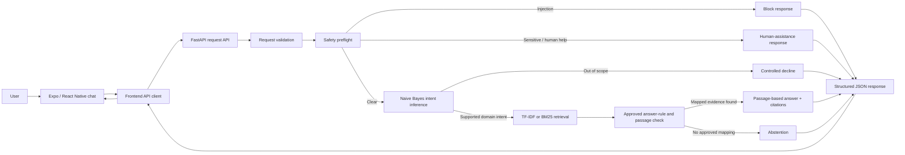
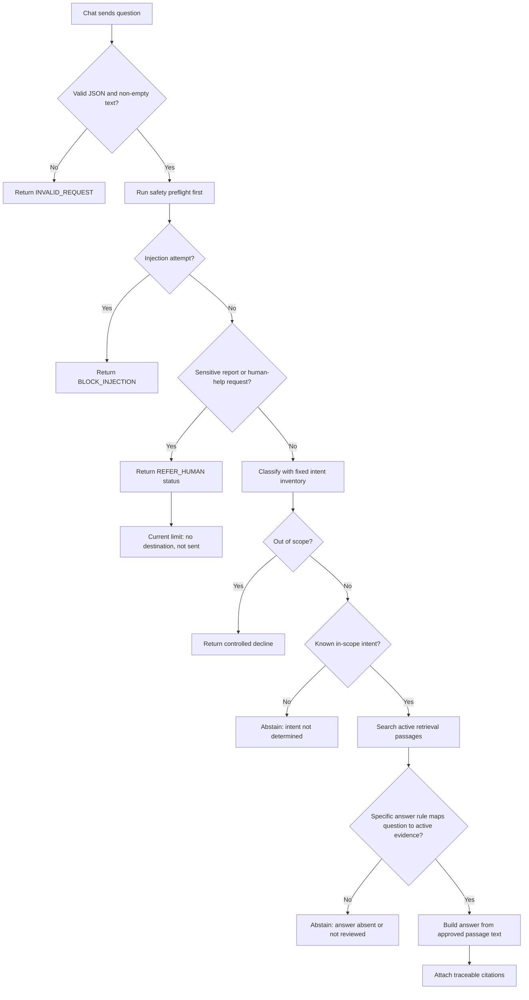
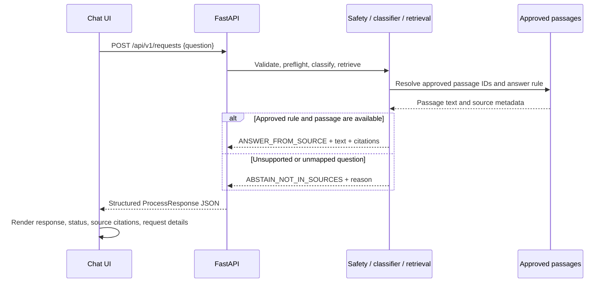

# Averse — Customer Support AI Project Explanation

**Project:** Customer Support Banking AI
**Assistant:** Averse  
**Project type:** Final-year ICT431 capstone prototype  
**Current implementation:** Local React Native/Expo client connected to a FastAPI backend

## 1. Project objective

The objective of Averse is to make approved Bank of Zambia (BoZ) consumer-information easier for people in Zambia to find and understand. A user asks a question in the chat. The backend applies safety checks, identifies a supported intent, searches approved passages and returns a response only when a narrow answer rule maps the question to source evidence. A source-backed response includes citations so the user can inspect the original material.

Averse is a controlled information assistant, not a general-purpose generative chatbot or a banking application. It does not access customer accounts, view balances or transactions, move money, submit official complaints, or provide personalised financial advice.

## 2. Current project scope

### In scope

- English-language banking consumer information for Zambia.
- Approved, retrievable passages based on public BoZ material.
- Ten fixed intents: `complaints_process`, `scam_fraud_warning`, `consumer_rights`, `payments_mobile_money`, `licensed_institutions`, `financial_education`, `regulations_directives`, `contact_regulator`, `human_help_request`, and `out_of_scope`.
- From-scratch Naive Bayes and softmax classifier implementations. The current runtime loads the frozen Naive Bayes artifact as an experimental intent classifier; the softmax model is not used for routing.
- From-scratch TF-IDF and BM25 retrieval implementations, using the shared deterministic text-processing pipeline. The local runtime selects one prototype retriever; the production choice is not established.
- A small answerability mapping for specific question forms with supporting active passages. Current mapped answers cover the BoZ complaint escalation sequence, checking an institution in the BoZ directory, and a limited description of BoZ consumer-protection priorities.
- Abstention when an approved passage and answer mapping do not support a response.
- Safety preflight for recognised injection attempts, sensitive situations and requests for human help.
- Source citations containing passage and source details.
- Local FastAPI endpoints and a React Native/Expo chat client.

### Out of scope in the current version

- Login, identity verification, customer profiles or access to personal banking data.
- User-specific balances, transactions or account information.
- Transfers, payments, account changes or official complaint submission.
- Personalised investment, savings or budgeting recommendations.
- Free-form generated factual answers, unapproved sources, and unreviewed knowledge-base passages.
- A live human referral destination. The current response can state that assistance is needed, but the referral is not sent and no official case reference is created.

The dataset does not contain a complete bank-customer-rights list, a direct BoZ complaint-submission method, or lost-card instructions. The assistant must say when those answers are not present rather than infer them.

## 3. System architecture

The classifier and retriever are candidate-selection components. A classification or high retrieval score does not by itself authorize an answer. The answer path uses the mapped passage text and attaches citations. If the required active passage or mapping is unavailable, the backend abstains.

## 4. Request flow

## 5. Response flow

The API also provides `GET /health`. A separate synthetic demonstration endpoint exists in the backend but is disabled by default and is not exposed as a customer complaint channel in the chat.

## 6. Data and response safeguards

- The runtime retrieval file contains 18 approved, retrieval-enabled passages. Review-only, excluded, rejected, and intentionally disabled sensitive passages are not eligible for ordinary retrieval.
- Classifier dataset v1.1.0 contains 275 training, 56 validation and 120 held-out records. The separate retrieval evaluation collections contain 15 validation and 30 test questions; they are not classifier training inputs.
- The runtime model is the Naive Bayes artifact trained from the project’s fixed intent labels. The model is not retrained at request time.
- Responses preserve source IDs, passage IDs, titles, URLs, dates and sections where a source answer is returned.
- Scores are not presented as probabilities or evidence guarantees.
- The human-assistance response is honest about the current limitation: no external person has been contacted, and no official reference has been issued.

## 7. Tools and software used

| Tool or software | Role in the project | Why it is used |
|---|---|---|
| Python 3.12+ | Backend, text processing, model and retrieval code | Provides a readable implementation language for the from-scratch academic components and the API service. |
| NumPy 2.5.4 | Vectorization, classifier calculations and retrieval math | Supports transparent numerical operations for the project’s Naive Bayes, softmax, TF-IDF and BM25 implementations. |
| FastAPI 0.162.4 | HTTP API | Connects the frontend to the local Python service with typed request handling and route definitions. |
| Pydantic 2.14.3 | Request and response schemas | Validates incoming JSON and keeps the frontend/backend response contract explicit. |
| Uvicorn 0.54.0 | Local ASGI server | Runs the FastAPI application during development and demonstrations. |
| pytest 9.2.0 | Automated tests | Exercises classifier, safety, service, retrieval and API behavior using focused cases and synthetic fixtures. |
| React Native 0.88.1 and React 19.3.0 | Chat interface | Build the mobile-oriented interface and its component model. |
| Expo SDK 58 | Frontend development runtime and web target | Runs the React Native app locally, including the browser-based presentation version. |
| React Navigation 7 | Screen navigation | Provides navigation among the existing app screens. |
| JSON | Passage store, datasets and model artifact | Keeps the approved corpus and frozen project data inspectable and versionable. |
| CSV | Source register and verification records | Stores source metadata and audit information in a simple tabular format. |
| SQLite | Local demonstration outbox only | Supports an optional local-only synthetic workflow; it is not customer account storage or an institutional referral system. |
| Git | Source and change history | Tracks project changes and supports preservation of frozen datasets and model artifacts. |

The model code does not use scikit-learn, PyTorch, transformers, pretrained models, hosted AI APIs or external vector databases. The intent classifier and retrieval ranking are implemented within the project using Python and NumPy.

## 8. Challenges and current limitations

1. **Small approved knowledge base.** Eighteen active passages do not cover every customer-service or digital-finance question. Some questions must abstain even when they are within the broad banking domain.
2. **Narrow answer mappings.** Retrieval can identify candidate passages, but a candidate match is not proof that the passage answers the user. Only a small set of question forms currently has explicit answer rules.
3. **Classifier coverage.** The Naive Bayes model was trained on a modest, fixed dataset. Unfamiliar vocabulary, short messages and phrasing variation can cause incorrect or unknown intents. Deterministic handling has been added for a few basic greetings and identity questions; this does not make the model a general language-understanding system.
4. **Conservative preprocessing.** The shared tokenizer and suffix rules are deliberately small and deterministic. They do not understand meaning, spelling errors or all English inflections.
5. **Sensitive referral gap.** Scams, fraud and human-help requests receive a safe referral status, but no real human contact destination is connected. The current system must not claim a message was sent.
6. **Limited evaluation data.** Retrieval evaluation has 15 validation questions, and classifier validation has 56 records. These small collections do not establish production performance.
7. **Changing source material.** BoZ publications and regulatory information can change. New material must be verified, approved, recorded in the register and reviewed before it becomes retrievable.
8. **Personalised finance is outside current scope.** Authentication alone would not make account questions or investment advice safe. They would require a formal scope change, trusted institution integrations, consent and privacy controls, security review, and supervision of any advice functionality.

## 9. Future plans

The following are proposed future features, not current capabilities:

1. **Dark mode:** add a user-selectable dark appearance while retaining the existing layout and accessibility behavior.
2. **Real human intervention:** connect the referral action to an approved human contact or support workflow. Before doing so, define who receives referrals, what data is sent, consent, secure transport, retention, response expectations and how a valid reference number is generated. Until then, the app must continue to say that no referral was sent.
3. **Broader, better-documented knowledge base:** curate and verify more public BoZ consumer-information passages, record their provenance and status, then add focused answer rules and evaluation cases. New answers should be enabled only after source review.
4. **Broader English vocabulary coverage:** add varied, natural question examples to future training data and improve deterministic preprocessing carefully. Keep training, validation and held-out test data separate, and re-evaluate before replacing a model artifact.
5. **Authentication and user-specific financial questions:** this is a major change from the current source-only, no-account-access scope. Balance and transaction questions would require an authorised banking data integration and strong identity, consent, privacy, access-control, audit and security controls. Salary-based investment or savings recommendations would additionally require a separately approved advice scope and suitable safeguards. These features should not be enabled by adding a login screen alone.

## 10. Development status

Averse is a locally running academic prototype with a connected chat client and API, experimental from-scratch classifiers and retrieval rankers, approved-source citations, narrow answer rules, controlled greetings and abstention behavior. It is not production-ready, does not provide account access or personalized advice, and does not deliver external human referrals.
