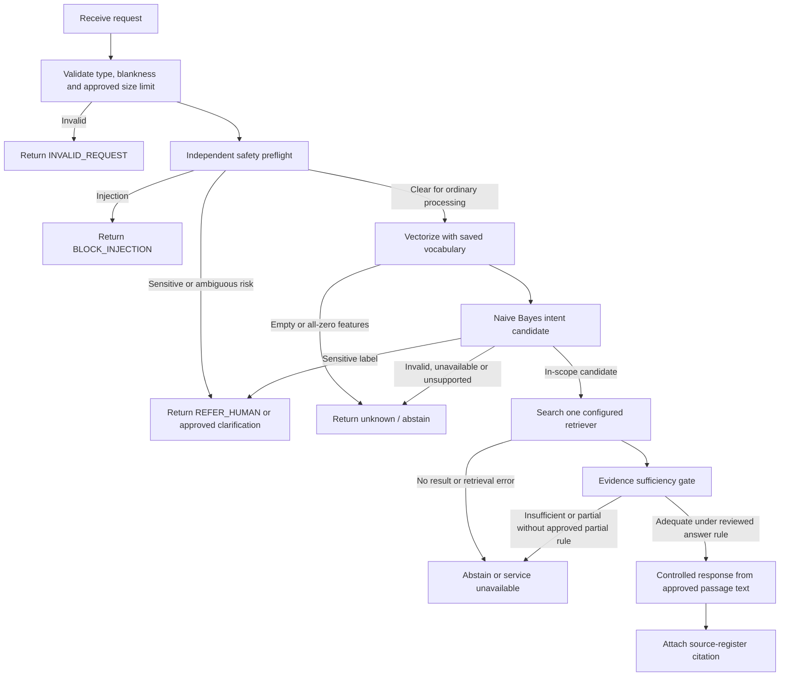

# Averse Day 6 Phase 1 Application Pipeline Design

**Project:** Averse — Customer Support AI for Zambian Banking Consumers  
**Inspection date:** 2026-11-14  
**Status:** Read-only repository inspection and proposed design. Application implementation has not started.

## 1. Executive summary

**VERIFIED:** The repository contains reusable text preprocessing, experimental intent classifiers, TF-IDF and BM25 retrievers, and offline validators/evaluators. It does not contain a request handler, application service, request/response schemas, or runtime referral workflow. `app/` currently contains only `app/__init__.py`.

The components are not yet an application pipeline. The classifier accepts numeric feature matrices rather than raw questions; its serialized-model restoration helper is in an evaluation module and accepts an already-loaded artifact dictionary. The retrievers share a useful `.search(query, top_k)` contract and return traceable source fields, but neither one decides whether a passage answers the user's question. The classifier and retrieval score must therefore remain routing/ranking signals only.

**PROPOSED:** Build the smallest backend as an in-process service with strict request/response schemas, an independent safety gate before classification and retrieval, a narrow Naive Bayes inference adapter, one startup-selected retriever, and a conservative evidence gate. Initially answer only cases backed by separately reviewed answer rules and controlled templates that cite approved passages. Abstain for everything else. Add an HTTP route only if the API contract is approved.

**UNRESOLVED:** The repository does not define the sensitive-request detection policy, referral destination or reference-number workflow, maximum question length, supported answer catalog, partial-answer policy, or a production retriever choice. These require project-owner or supervisor decisions before an answer-capable service can be approved.

## 2. Scope and inspection method

This phase was read-only except for creating this report. I inspected the repository structure, Git status, application and ML source, scripts, tests, dependency/configuration files, and project documentation. I did not run tests, classifiers, retrieval, evaluators, trainers, or validators. I did not open, parse, or inspect any held-out dataset. In particular, I did not run `scripts/validate_day3_v1_1.py`; its source shows that it loads both answerable validation and answerable test collections.

No application, classifier, retriever, model, dataset, evaluation, configuration, or existing report file was changed. The only file created for this phase is this design report.

## 3. Repository architecture findings

### Verified structure

- `app/` contains only `__init__.py`; there is no HTTP route, request handler, application service, orchestration layer, or app-level test.
- `ml/` contains `text_processing.py`, `intent_classifier.py`, `evaluation.py`, `retrieval.py`, and `retrieval_evaluation.py`.
- `data/` contains the approved and materialized retrieval files, source-register/audit files, versioned classifier files, and test collections. Only names were inventoried; held-out collection contents were not opened.
- `scripts/` contains dataset builders, classifier training/validation/evaluation, the Day 5 validation-only retrieval evaluator, and KB validation utilities.
- `tests/` contains unit and offline-evaluation tests for ML components. There are no application-pipeline tests.
- Root dependencies pin NumPy, FastAPI, Pydantic, and pytest. FastAPI and Pydantic are available but no application module currently imports them. No additional dependency is needed for the proposed design.
- `pytest.ini` configures pytest discovery. No application configuration or service entry point was found.

The repository is on `main` at `732faf3a301006f6dc1e788dae1127013845b898`. The working tree has the same pre-existing changes recorded in the preceding Day 5 phase: modified Day 4/project files, the pre-existing deletion of `data/passages.json`, and untracked Day 4/Day 5 artifacts. There is no staged diff. These were preserved. The README and knowledge-base documentation identify the deleted `data/passages.json` as a former fictional placeholder; it is not an active retrieval input.

### Documentation chronology

`docs/DAY_4_CLOSURE_REPORT.md` says Day 5 had not started, while the later `docs/DAY_5_RETRIEVAL_ENGINE_COMPLETION_REPORT.md` and the present retrieval modules show that Day 5 was subsequently completed. The Day 4 statement is a historical milestone note, not the current application architecture. Both current project documentation and `app/` agree that there is still no request pipeline.

## 4. Existing component inventory

| Component | Verified interface and contract | Validation and failure behavior | Integration assessment |
|---|---|---|---|
| Shared preprocessing — `ml/text_processing.py` | `preprocess_text(text: str) -> list[str]`; also exposes `tokenize`, `remove_stop_words`, and `stem_token`. Version is `TEXT_PROCESSING_VERSION = "2.0.0"`. It case-folds, tokenizes alphabetic strings and numbers, removes a short stop-word list, then applies conservative domain/suffix normalization. | Non-string input raises `TypeError`. It is lexical preprocessing, not phrase or semantic understanding. Negation and selected question words are retained. | Reuse through `TextVectorizer.transform`; do not change it for integration. Do not rely on its stemming as the safety detector. |
| Text vectorizer — `ml.intent_classifier.TextVectorizer` | `fit(questions) -> TextVectorizer`, `transform(questions) -> np.ndarray`, and `fit_transform(questions) -> np.ndarray`. It creates a sorted train-time unigram vocabulary and count features. | Transform before fit raises `ValueError`; non-string questions raise `TypeError`; out-of-vocabulary terms are ignored. A fully unknown/empty request becomes an all-zero feature row. | Suitable as a component after restoring the saved vocabulary. It does not accept one raw question as a classifier request by itself. |
| Naive Bayes — `ml.intent_classifier.MultinomialNaiveBayes` | `fit(features, labels, classes) -> self`, `predict(features) -> list[str]`, `predict_proba(features) -> np.ndarray`, and `predict_log_proba(features) -> np.ndarray`. Feature rows must match the fitted vocabulary width. | Unfitted or malformed input raises `ValueError`. Probabilities are normalized outputs, not approved confidence thresholds. An all-zero feature row is scored from class priors and still receives a class label. | Leading experimental candidate only. A runtime adapter should detect empty/all-zero evidence and return an unknown/abstain decision instead of accepting the prior-only label. |
| Softmax — `ml.intent_classifier.SoftmaxRegression` | `fit(...) -> self`, `decision_function(features)`, `predict_proba(features)`, `predict(features)`, and serialization through `to_dict()`. | Fitted-state, feature shape, finite-value, and parameter checks raise `ValueError`. | Do not use for routing or safety. Day 4 records 11/56 correct and `out_of_scope` for every validation example. |
| Classifier artifact restoration — `ml.evaluation.load_serialized_models(artifact: dict[str, Any], *, classes: Sequence[str] = FIXED_INTENTS) -> tuple[TextVectorizer, MultinomialNaiveBayes, SoftmaxRegression]` | Restores parameters from an in-memory dictionary; validates versions, class ordering, dimensions, counts, and configuration. It does not itself read a model path. `ml.evaluation.evaluate_files(...)` reads a supplied validation file and model file, then evaluates both classifiers. | Invalid artifact metadata, shapes, or values raise `ValueError`. The loader requires the artifact's `evaluation_status` to be `"not_evaluated"`. | The evaluation workflow is not a runtime request API. Do not call `evaluate_files` from an application. A runtime-specific loading/prediction boundary is needed; avoid silently routing through the softmax model. |
| Corpus loader — `ml.retrieval.load_corpus(source: str | Path | Sequence[Mapping[str, Any]]) -> list[Passage]` | Reads JSON from a supplied path or validates supplied records. `Passage` is immutable and includes passage ID, topic, text, source ID/title/URL, dates, section/page, status, and retrieval-enabled flag. | Rejects empty/duplicate IDs, missing required metadata, non-approved/disabled records, sensitive topics, malformed records, and an empty corpus with `ValueError`. The function accepts arbitrary supplied paths/records; it does not enforce the canonical file path itself. | At app startup, call it only with `data/retrieval_passages.json`; do not pass the broader approved file or evaluation data. |
| Retrievers — `TfidfRetriever` and `BM25Retriever` in `ml/retrieval.py` | Both expose `search(query: str, top_k: int = 3) -> list[RetrievalResult]`. BM25 has fixed defaults `k1=1.5`, `b=0.75`. Results include passage/source IDs, source citation fields, raw score, rank, and method. Passage text remains in the loaded `Passage`. | Invalid query type raises `TypeError`; invalid `top_k` raises `ValueError`; empty/OOV queries return `[]`. Construction revalidates eligibility and source metadata. | Common method shape is sufficient for a small startup-selected retriever. No new abstraction is required initially. Scores are not answer authorization. |
| KB checks — `validate_knowledge_base.py`, `build_retrieval_dataset.py` | `run_validation()` checks knowledge-base structure, joins, dispositions, metadata, and active-set membership. `build_retrieval_dataset.py --check` compares the materialized set with approved/enabled records. | Structural validation can fail with errors; both are inspection tools, not request-time services. The KB validator explicitly does not prove factual accuracy or legal currentness. | Use in development/release checks, not in the per-request pipeline. They were not run in this phase. |
| Retrieval evaluation — `ml/retrieval_evaluation.py`, `scripts/evaluate_day5_retrieval.py` | Offline metric functions and a script pinned to the validation collection and retrieval corpus. | The script reads those validation inputs and is an evaluation command. | Do not use in a request handler. It was not run in this phase. |

### Day 4 and Day 5 evidence status

**REPORTED IN EXISTING DOCUMENTS, NOT RERUN HERE:** Day 4 records Naive Bayes at 51/56 validation correct (91.07%) and softmax at 11/56 with all examples predicted `out_of_scope`. Naive Bayes is experimental, not production-ready. Day 5 records both retrieval methods at P@1 = 1.0, R@1 = 1.0, and MRR = 1.0 on 15 answerable validation questions. That small retrieval experiment does not establish answer sufficiency, abstention, safety, or production performance.

## 5. Actual interface contracts and missing pieces

**VERIFIED:** No existing type represents an application request or response. No method accepts a raw question and returns a complete, cited answer. The classifier requires a vectorizer transformation followed by a model call. Retrieval returns ranked references, not response text. There is no evidence-sufficiency checker, response-template builder, source-register response adapter, safety/referral service, referral reference generator, readiness check, API endpoint, or user-content logging policy.

**PROPOSED:** A single application service can expose an interface such as `process_request(request: ProcessRequest) -> ProcessResponse`. Keep internal classification, retrieval, evidence, and response work as ordinary functions or collaborators inside this service until real complexity requires more layers. The service should be initialized once with a validated model, active corpus, source lookup, safety rules, and one fixed retriever choice.

## 6. Proposed end-to-end request pipeline

The proposed order changes the conceptual list in the request: independent injection and sensitive-request screening must happen before ordinary classification or retrieval. The project dataset specification explicitly requires injection blocking before classification and referral for scam/fraud or human-help requests without ordinary retrieval.



The diagram is **PROPOSED**; none of these application stages currently exists. A request should not reach retrieval unless preflight allows it, classification is valid, and the intent is eligible for ordinary retrieval. A sensitive classifier label is a second safety fence, not the primary detector. An out-of-scope or unknown prediction should not produce a factual answer. The owner must approve whether an out-of-scope label declines directly or asks for clarification, given the classifier's experimental status.

## 7. Independent safety and referral design

### Verified facts

- `scam_fraud_warning` and `human_help_request` are fixed sensitive intents in the project specification.
- Their approved passages remain retrieval-disabled; the active corpus has no passage for either intent.
- Dataset policy says scam/fraud and explicit human-help requests use `REFER_HUMAN` without retrieval.
- Prompt-injection attempts are to be blocked before classification and retrieval.
- No runtime safety detector, referral destination, reference-number generator, or referral handoff exists in `app/`.

### Proposed controls

1. Run a separately maintained safety preflight on the raw request before the classifier. It should include the project-approved injection and sensitive-request rules; it must not depend on a classifier label or retrieval score.
2. If the preflight detects a sensitive request, injection attempt, or unresolved safety ambiguity, bypass ordinary retrieval. Use a supervisor-approved `REFER_HUMAN`, `BLOCK_INJECTION`, or clarification outcome.
3. If ordinary classification later predicts either sensitive intent, apply the same referral gate even if the preflight did not match. Never let the classifier downgrade an explicit safety finding.
4. Keep matching rules explicit, versioned, and testable. The shared stemming/tokenization is designed for lexical retrieval and is not, by itself, a safety detector. Rule coverage and false-positive/false-negative behavior require review.
5. Fail closed if a safety check cannot run: do not classify for an answer, do not retrieve, and return an approved unavailable/referral status.

**UNRESOLVED / OWNER APPROVAL REQUIRED:** The exact phrases/rules, handling of negation and quoted scam examples, ambiguous language, and referral target are not defined. The specification expects a referral reference number, but the project has no channel that can create or deliver a real referral. A local request ID must not be represented to users as a completed referral. Approve the contact route, reference-number semantics, and wording before making the user-facing referral flow operational.

## 8. Retrieval integration design

**VERIFIED:** `TfidfRetriever` and `BM25Retriever` share `.search(query, top_k=3)` and return the same `RetrievalResult` structure. `load_corpus` validates passage eligibility and metadata. The rankers do not load knowledge themselves; the caller supplies a corpus. `RetrievalResult.score` is a raw ranking score.

**PROPOSED:** Load only `data/retrieval_passages.json` during service startup, validate the whole corpus, instantiate one ranker, and keep it for the service lifetime. Select the method through a fixed startup setting or injected object; do not run both rankers for every request or switch per question. Day 5 validation does not show a production winner, so a production choice must be explicit and approved. Use the current `search` contract directly; do not add a retriever framework until a second backend actually requires it.

Treat `[]` as “no candidate evidence,” not as permission to search another source. A retriever exception, invalid corpus, or missing citation metadata must not trigger fallback to general knowledge or unapproved files. `load_corpus` allows arbitrary caller paths, so pinning the canonical corpus is an application responsibility.

For citations, retain `passage_id` and `source_id`, then resolve displayed title and official URL through `data/sources_register_final.csv` as required by `docs/KNOWLEDGE_BASE_README.md`. Do not construct URLs. The source register is the documented authority for the public title/link; the passage's `section_or_page` supplies the locator. A missing or mismatched source join should fail closed.

## 9. Evidence sufficiency and abstention

No current code judges whether a passage adequately answers a question. Lexical overlap and retrieval rank are candidate-generation signals only. The current 15 annotated validation questions are not an answerability policy or a basis for selecting a production score threshold.

| Evidence state | Proposed handling |
|---|---|
| No results | `ABSTAIN_NOT_IN_SOURCES`; say the requested information is not in the approved sources using a fixed template. |
| Results are irrelevant or do not directly support the requested claim | Abstain. Do not treat a high score or matching intent as proof of relevance. |
| Results are relevant but incomplete | Answer only a separately reviewed, explicitly supported sub-question if a partial-response rule exists; otherwise abstain for the request. Do not fill gaps from general knowledge. |
| Results adequately support the requested response | Answer only when a reviewed answer rule maps the request/claim to specific approved passage IDs and all response claims are covered. Use passage text verbatim or an approved fixed template and cite each source. |

**PROPOSED MVP evidence mechanism:** Begin with a small, separately authored and supervisor-reviewed answerability catalog. Each entry should specify a narrowly phrased request type, allowed intent, approved passage ID(s), the claims those passages support, any prohibited extrapolation, and an approved response template. Do not derive runtime rules from the retrieval validation collection. Until such a catalog exists, the service may demonstrate routing and retrieval internally but should abstain from returning an answer to users.

**UNRESOLVED:** Whether partial answers are allowed, how multi-part requests are decomposed, how ambiguity is clarified, who approves the answer catalog, and what source freshness checks are required. No threshold is recommended or implied.

## 10. Response and citation structure

The following is a **PROPOSED** Pydantic contract (Pydantic is already listed in `requirements.txt`); no such model currently exists:

```python
class Citation(BaseModel):
    passage_id: str
    source_id: str
    source_title: str
    source_url: str
    publication_date: str | None
    accessed_date: str
    section_or_page: str

class ProcessResponse(BaseModel):
    request_id: str
    action: Literal[
        "ANSWER_FROM_SOURCE", "ABSTAIN_NOT_IN_SOURCES", "REFER_HUMAN",
        "DECLINE_OUT_OF_SCOPE", "BLOCK_INJECTION", "INVALID_REQUEST",
        "SERVICE_UNAVAILABLE",
    ]
    response_text: str
    intent: str | None
    citations: list[Citation]
    reason_code: str | None
    referral_reference: str | None
```

`referral_reference` is populated only after an approved referral mechanism returns a real reference. It must not be fabricated. Do not expose classifier probabilities or retrieval scores as customer confidence. Keep diagnostic method/score internal and only if there is an approved, privacy-conscious logging policy. For abstention, referral, and out-of-scope actions, use reviewed fixed wording; do not generate free-form factual text.

## 11. Error handling and security

| Condition | Proposed handling |
|---|---|
| Missing, non-string, or whitespace-only question | Reject as `INVALID_REQUEST`; do not call classifier or retrieval. |
| Excessively long question | Reject before model calls using a maximum length approved by the project owner. No numeric limit is currently defined. |
| Injection or explicit sensitive request | Block or refer before classification/retrieval under approved rules. Do not claim a handoff occurred unless it did. |
| Classifier/model load failure | Fail application readiness at startup; do not fall back to softmax or answer without classification. |
| Invalid class label, prediction shape, or all-zero/OOV feature row | Do not retrieve; return a safe unknown/abstention or unavailable response. Never accept the Naive Bayes prior-only prediction as reliable intent. |
| Invalid corpus or passage metadata | Fail startup. Do not silently drop an invalid passage or load another file. |
| Retrieval returns no results | `ABSTAIN_NOT_IN_SOURCES`. |
| Retrieval raises unexpectedly | Return a safe unavailable response; do not produce an answer. |
| Unexpected exception | Catch at the service boundary, return a generic error with a request ID, and log a sanitized error category. Do not log the raw question, account details, credentials, or full passage content. |

The request size limit, allowed character policy, retention duration, and operational log fields require approval. Do not support account access, transactions, or individual case handling.

## 12. Proposed minimum application structure

```text
app/
  __init__.py
  schemas.py       # request/response contracts
  safety.py        # independent pre-classifier and referral gates
  service.py       # one request orchestrator and controlled response builder
  main.py          # optional FastAPI adapter, only if an HTTP API is approved
ml/
  model_io.py      # validated shared artifact restoration (if extracted)
  inference.py     # runtime Naive Bayes adapter; no fitting/evaluation
tests/
  test_app_safety.py
  test_model_io.py
  test_inference.py
  test_app_service.py
  test_app_api.py  # only if main.py is implemented
```

This is a **PROPOSED** target, not the current tree. Keep evidence assessment inside `app/service.py` at first; add a separate module only if the approved answer catalog or rules make it necessary. No frontend is proposed.

## 13. Required tests and test scenarios for implementation

Use synthetic requests, model dictionaries, and passage fixtures. Do not use or open held-out datasets in application tests.

- Request schema rejects missing, non-string, blank, and over-limit questions.
- Injection and sensitive rules run before classifier and retriever; assert both downstream components were not called.
- Sensitive classifier output triggers the referral gate even when the preflight detector does not match.
- Ambiguous sensitive wording follows the approved clarification/referral rule; include quoted and negated cases to measure false triggers.
- All-zero/OOV vector produces unknown/abstention, not a prior-only routed intent.
- Runtime artifact loader rejects wrong version, preprocessing version, class order, dimensions, non-finite values, and malformed model data; it never calls `fit` and never reads a dataset.
- Classifier output outside the fixed intent labels stops the request before retrieval.
- Both retrievers can be injected under the same interface; tests verify the selected method is fixed for a service instance.
- Canonical corpus initialization rejects disabled, unapproved, sensitive, duplicate-ID, and missing-source-metadata fixtures.
- No results, irrelevant evidence, partial evidence, and fully mapped evidence each produce the approved action. Tests must prove that a large raw score alone cannot authorize a response.
- Citation fields exactly match the selected passage/source-register record; unsupported claims and invented URLs are absent.
- Loader failures and unexpected service exceptions return safe errors without leaking question text into logs.
- If FastAPI is added, route tests cover request validation, service-unavailable behavior, and response schema only; no frontend test is in scope.

## 14. Phased implementation sequence for the next milestone

### Phase A — Approve policy and contracts

- **Objective:** Settle referral, safety, evidence, input-limit, output, and deployment decisions before code chooses behavior.
- **Files:** No runtime files. Record decisions in the project’s approved decision process; do not repurpose datasets as policy.
- **Interfaces:** Approve `ProcessRequest`, `ProcessResponse`, action names, referral semantics, and the source-register citation rule.
- **Tests:** No execution yet; approve a synthetic scenario matrix for the next phase.
- **Dependencies:** None.
- **Acceptance:** Named owner approves sensitive/injection rules, ambiguous-case handling, actual referral destination/reference process, maximum input length, answerability catalog scope, partial-answer behavior, and whether HTTP is required.
- **Risks:** Implementation without these decisions would encode invented policy or imply referrals that are not delivered.

### Phase B — Add request validation and independent safety preflight

- **Objective:** Implement an isolated, deterministic gate that can block injection and route sensitive requests without loading the classifier or retriever.
- **Files:** Create `app/schemas.py`, `app/safety.py`, and `tests/test_app_safety.py`.
- **Interfaces:** `ProcessRequest` validation; a small `SafetyDecision` result (`CLEAR`, `BLOCK_INJECTION`, `REFER_HUMAN`, or an owner-approved ambiguity action).
- **Tests:** Synthetic explicit, paraphrased, quoted, negated, ambiguous, and out-of-scope inputs; call-order tests prove no classifier/retriever call on block/referral.
- **Dependencies:** Standard library; Pydantic is already pinned if selected for schemas.
- **Acceptance:** Approved rules and size limits are enforced deterministically; all safety outcomes bypass ordinary retrieval; no user content is logged.
- **Risks:** Phrase rules can miss paraphrases or over-trigger; measured coverage does not prove safety completeness.

### Phase C — Add runtime Naive Bayes loading and prediction adapter

- **Objective:** Provide a one-question inference interface using the frozen Naive Bayes artifact without fitting, evaluating, or using softmax.
- **Files:** Create `ml/inference.py` and `tests/test_inference.py`. If review finds it necessary to avoid duplicated artifact checks, extract the validated restoration logic to `ml/model_io.py` and preserve `ml.evaluation.load_serialized_models` compatibility with focused tests.
- **Interfaces:** A startup loader and a method such as `predict_intent(question: str) -> str | None`; it performs vectorization with the saved vocabulary and returns no intent for all-zero features.
- **Tests:** Synthetic artifact only; malformed artifacts, wrong class/preprocessing versions, empty/OOV question, invalid types, stable labels, and proof that no fit/evaluation/dataset file is called.
- **Dependencies:** Existing NumPy and Python standard library only.
- **Acceptance:** The adapter loads the approved model version, uses the fixed classes and shared preprocessing, never fits, returns a validated label or explicit unknown, and does not invoke softmax.
- **Risks:** The current deserializer is in an evaluation module and validates both model parameter sets; refactoring must not change Day 4 predictions or artifacts.

### Phase D — Add the application service, evidence gate, and controlled responses

- **Objective:** Orchestrate safety, candidate intent, retrieval, evidence policy, abstention/referral, and source-grounded response construction.
- **Files:** Create `app/service.py` and `tests/test_app_service.py`; add only the owner-approved answer catalog/source lookup required by the chosen design. Do not alter KB or evaluation datasets.
- **Interfaces:** `process_request(ProcessRequest) -> ProcessResponse`; inject classifier, retriever, safety policy, and response rules for isolated tests.
- **Tests:** Synthetic end-to-end cases for every action, no-results, irrelevant, partial, adequate support, error paths, source joins, and assurance that sensitive input never reaches retrieval.
- **Dependencies:** Existing NumPy/Pydantic; no new model or service dependency.
- **Acceptance:** Only an approved answer rule plus all required source evidence can yield `ANSWER_FROM_SOURCE`; otherwise fail closed. Text and citations use approved passage/source-register content and reviewed templates.
- **Risks:** The answer catalog is manual and intentionally narrow; incomplete coverage produces abstentions. No score threshold may substitute for evidence rules.

### Phase E — Add an HTTP adapter only if approved

- **Objective:** Expose the tested service through a small backend endpoint without adding frontend behavior.
- **Files:** Create `app/main.py` and `tests/test_app_api.py`.
- **Interfaces:** One request route, a readiness/health response, and the approved Pydantic contract.
- **Tests:** Synthetic HTTP tests for validation, request-size limits, action responses, startup-unavailable conditions, and sanitized errors.
- **Dependencies:** Existing FastAPI and Pydantic pins; no installation is needed.
- **Acceptance:** HTTP is a thin adapter; all policy stays in the service, and no request bypasses safety or evidence checks.
- **Risks:** Deployment, authentication, rate limiting, privacy, availability, and operational referral delivery are not specified in this repository and require separate review before public deployment.

## 15. Risks, limitations, and unresolved decisions

- Classifier performance is experimental; no probability is calibrated or approved as a threshold.
- An all-zero classifier feature row returns the prior-most class under Naive Bayes unless the runtime adapter intercepts it.
- Retrieval validation is small and answerable-only; it cannot establish abstention or answer adequacy.
- No existing implementation can determine semantic relevance or completeness from ranked passages.
- Safety rules and a genuine human referral mechanism do not exist. A local request ID is not a referral reference.
- The active corpus has no scam/fraud or human-help passages; this is an intentional safety constraint. KB027–KB028 remain under review.
- Mobile-money guidance is limited. The knowledge-base documentation warns that current transaction, fee, reversal, failed-payment, and complaint-timeline instructions are not verified.
- The live source register is documented as the authority for displayed source title and URL. Source currency and current legal status require human source review.
- Existing project documentation includes historical milestone statements; use actual current files and later completion reports to determine present implementation.
- The static review did not run tests, validators, or evaluators. This report makes no new claims about their current runtime results.

## 16. Decisions requiring project-owner or supervisor approval

1. Exact sensitive-request and prompt-injection rules, including ambiguous, quoted, negated, and adversarial wording.
2. Human referral destination, whether a real external handoff exists, how a reference number is created, and what the user may be told before delivery is confirmed.
3. Which request types may be answered and the reviewed passage-to-claim/template catalog; how partial or multi-part answers are handled.
4. The maximum accepted question length and request/response fields exposed to clients.
5. Whether an HTTP API is required in the next milestone and its deployment/security expectations.
6. Which single retriever method is fixed for an initial deployment. Day 5 validation gives no evidence-based production winner; configuration must not become a per-request switch.
7. How out-of-scope and unknown classifier outcomes are phrased and whether clarification is allowed.

## 17. Final readiness assessment

**VERIFIED:** The core text, classifier, retrieval, result, and validation interfaces exist and are understandable. The repository is the expected Averse project. The current application package has no pipeline, and the source tree contains no implementation that performs safety-first routing, evidence sufficiency, or cited response construction.

**PROPOSED:** The architecture can proceed to review as a phased, deterministic backend plan. Begin with approved safety and response contracts, then implement the independent gate and a narrow Naive Bayes adapter, then wire retrieval behind a strict evidence catalog. Keep HTTP optional and later.

**UNRESOLVED:** The system is not ready to serve factual answers or claim successful human referrals until the decisions in Section 16 are approved and their tests pass. Do not begin Day 6 implementation until this design has been reviewed and explicitly approved.
